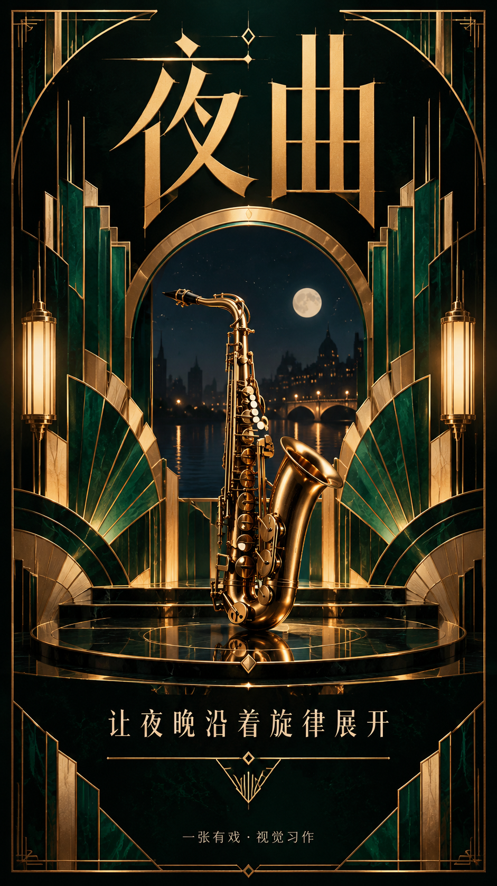
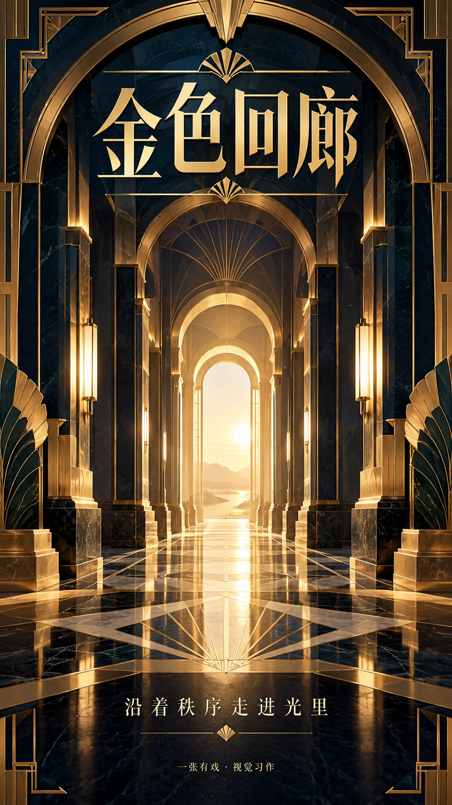
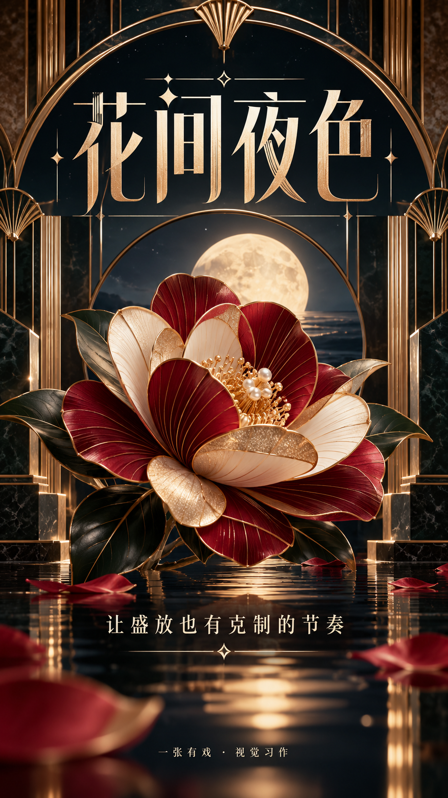
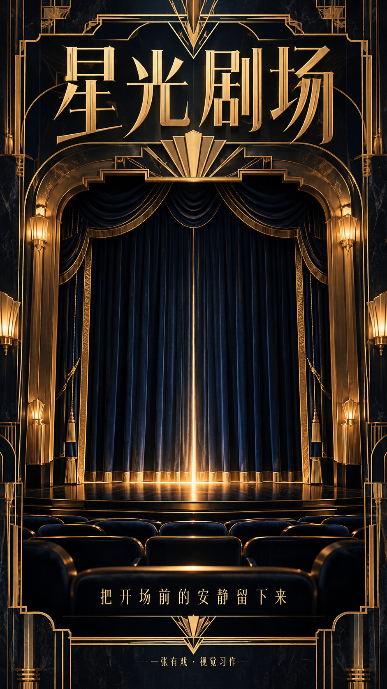
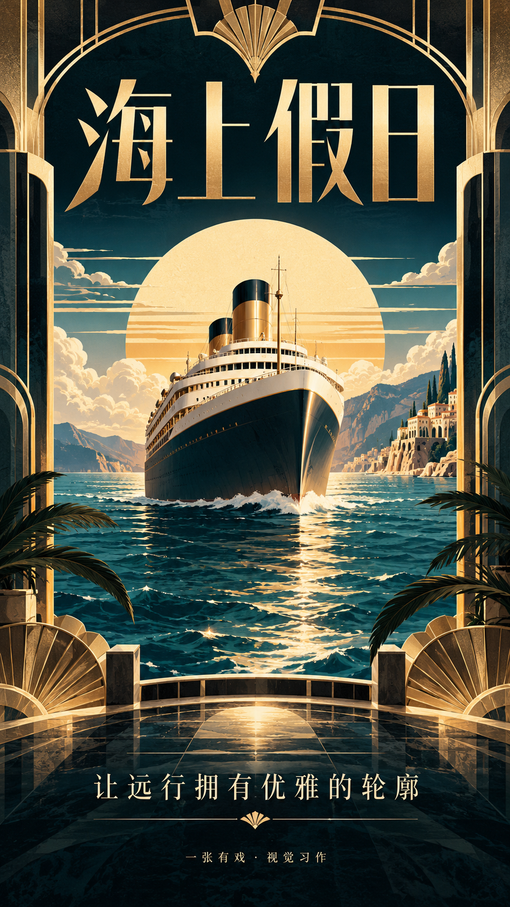
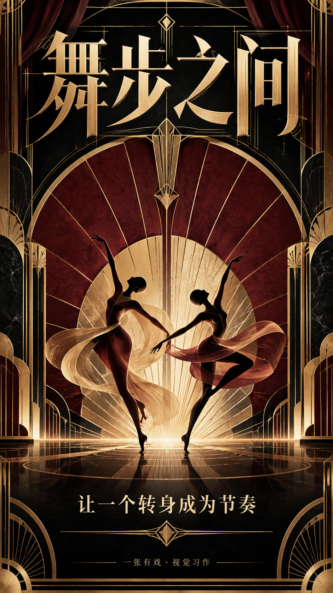
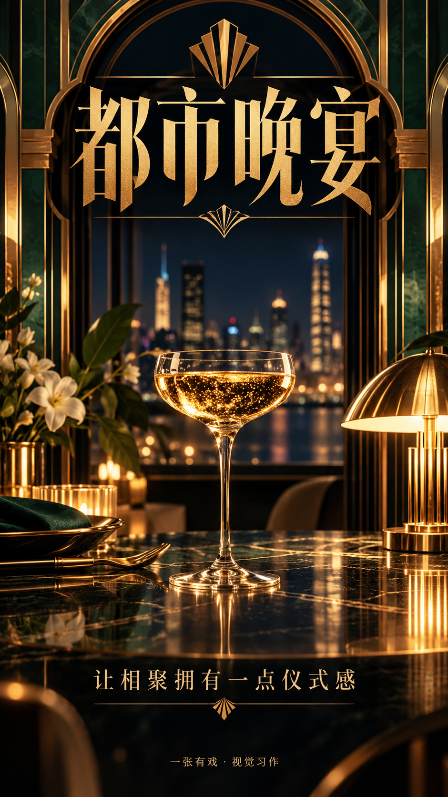

# 装饰艺术 · Art Deco Luxe Poster Skill

一张有戏「装饰艺术」风格中文海报技能。9:16 竖版，主标题 + 短句 + 页脚，简洁可控。

A poster-generation skill for the **art deco luxe** style by 一张有戏 (EricChan): 9:16 portrait, Simplified Chinese, one headline, one supporting line.

## 作品展示 · Gallery

<table>
<tr><td align="center"> 夜曲</td><td align="center"> 银幕之夜</td><td align="center"> 金色回廊</td></tr>
<tr><td align="center"> 花间夜色</td><td align="center"> 星光剧场</td><td align="center"> 海上假日</td></tr>
<tr><td align="center"> 舞步之间</td><td align="center"> 都市晚宴</td></tr>
</table>

## 使用 · Usage
See [SKILL.md](SKILL.md). Full prompts: [PROMPTS.json](PROMPTS.json). 小红书配文：[XIAOHONGSHU_COPY.md](XIAOHONGSHU_COPY.md).

## 来源 · Credits
Adapted from [howardz27/poster-generator-skill](https://github.com/howardz27/poster-generator-skill) (MIT, © 2026 yinnhao). See [SOURCES.md](SOURCES.md).

## License
MIT © 2026 EricChan (ericchan916)
